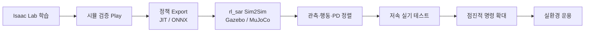
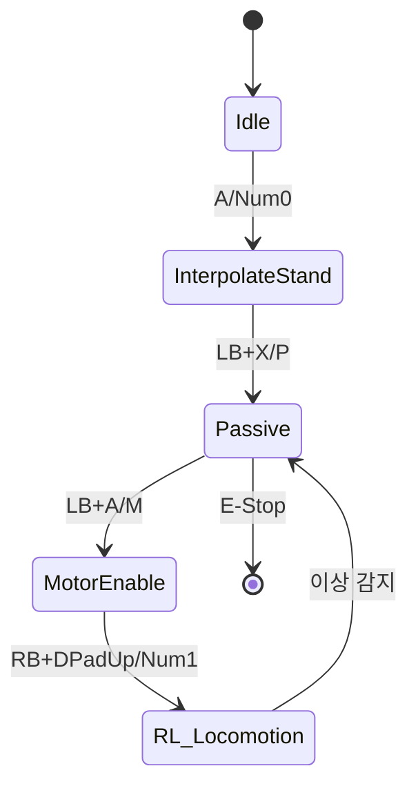

# Unitree Go2W Sim-to-Real 이식 절차서

본 문서는 `robot_lab`에서 학습한 **Unitree Go2W** 정책을 실제 로봇에 이식하기 위한 절차를 정의합니다.

- **기준 태스크**: `RobotLab-Isaac-Velocity-Rough-Unitree-Go2W-v0`
- **권장 배포 프레임워크**: [rl_sar](https://github.com/fan-ziqi/rl_sar) (robot_lab README 공식 권장)
- **관련 문서**: [안정성 보상함수 정리](./unitree_go2w_stability_rewards.md)

---

## 1. 개요

### 1.1 파이프라인




### 1.2 핵심 원칙

1. **시뮬에서 충분히 수렴한 정책만 이식**한다.
2. **관측 벡터 순서·스케일·부호**가 시뮬과 1:1 일치해야 한다.
3. **Gazebo/MuJoCo 중간 검증** 없이 바로 실기에 올리지 않는다.
4. **저속·서스펜션·비상정지** 절차를 반드시 갖춘다.
5. 모든 실기 테스트는 **2인 이상(조작자 + 안전 감시자)** 으로 수행한다.

---

## 2. 사전 요구사항

### 2.1 하드웨어


| 항목    | 요구사항                               |
| ----- | ---------------------------------- |
| 로봇    | Unitree Go2W (배터리 충전 완료)           |
| 제어 PC | Ubuntu 20.04/22.04, GPU 불필요 (추론용)  |
| 네트워크  | 유선 LAN 권장 (무선은 패킷 손실 위험)           |
| 안전 장비 | 서스펜션 리깅, 비상 정지 스위치, 안전 구역 확보       |
| 입력 장치 | Xbox 호환 게임패드 또는 키보드 (rl_sar 기본 지원) |


### 2.2 소프트웨어


| 구분       | 버전/도구                                       |
| -------- | ------------------------------------------- |
| 학습 환경    | Isaac Sim 5.x + Isaac Lab 2.3.x + robot_lab |
| 추론 런타임   | libtorch (`.pt`) 또는 onnxruntime (`.onnx`)   |
| 실기 배포    | rl_sar (`./build.sh -m` CMake 빌드)           |
| 로봇 SDK   | Unitree SDK2 (rl_sar 서브모듈 포함)               |
| 학습 프레임워크 | RSL-RL (PPO)                                |


### 2.3 네트워크 설정 (유선 연결)

```text
로봇 IP      : 192.168.123.161 (기본)
PC IP        : 192.168.123.222 (동일 서브넷, 마지막 옥텟 변경 가능)
서브넷 마스크 : 255.255.255.0
```

네트워크 인터페이스 확인:

```bash
ifconfig
# 예: enxf8e43b808e06 → 이 이름을 배포 시 인자로 사용
```

---

## 3. Phase 0 — 학습 완료 및 시뮬 검증

### 3.1 학습

```bash
python scripts/reinforcement_learning/rsl_rl/train.py \
    --task RobotLab-Isaac-Velocity-Rough-Unitree-Go2W-v0 \
    --headless
```

학습 로그 위치:

```text
logs/rsl_rl/unitree_go2w_rough/<날짜_시간>/
├── model_<iteration>.pt
├── params/env.yaml      # 관측·행동·PD 설정 스냅샷
└── params/agent.yaml    # 네트워크 구조
```

### 3.2 시뮬 Play 검증

```bash
python scripts/reinforcement_learning/rsl_rl/play.py \
    --task RobotLab-Isaac-Velocity-Rough-Unitree-Go2W-v0 \
    --num_envs 16 \
    --load_run <run_folder_name> \
    --checkpoint model_<iteration>.pt
```

**합격 기준 (시뮬)**

- Rough terrain에서 추락/전복 없이 20초 이상 주행
- 명령 속도 추적이 안정적 (급격한 진동 없음)
- 관절 한계·비정상 접촉 패널티가 지속적으로 높지 않음
- Flat 환경(`RobotLab-Isaac-Velocity-Flat-Unitree-Go2W-v0`)에서도 동작 확인 (선택)

> Flat 환경에서 먼저 검증한 뒤 Rough 정책을 실기에 올리면 리스크를 줄일 수 있습니다.

---

## 4. Phase 1 — 정책 Export

`play.py` 실행 시 체크포인트와 동일 경로에 자동 export됩니다.

```text
logs/rsl_rl/unitree_go2w_rough/<run>/model_<iter>.pt
logs/rsl_rl/unitree_go2w_rough/<run>/exported/
├── policy.pt     # TorchScript (libtorch)
└── policy.onnx   # ONNX (onnxruntime)
```

### 4.1 Export 확인

```bash
ls -la logs/rsl_rl/unitree_go2w_rough/<run>/exported/
```

### 4.2 정책 네트워크 사양


| 항목           | 값                                          |
| ------------ | ------------------------------------------ |
| 구조           | MLP [512, 256, 128], ELU                   |
| 관측 정규화       | **비활성** (`actor_obs_normalization: false`) |
| 출력           | 16차원 연속 행동 (Gaussian mean, 추론 시 mean 사용)   |
| 초기 noise std | 1.0 (추론 시 미사용)                             |


---

## 5. Phase 2 — 인터페이스 정렬 (가장 중요)

실기 이식 실패의 80% 이상은 **관측·행동 매핑 불일치**에서 발생합니다. 아래 표를 반드시 준수하세요.

### 5.1 제어 주기


| 항목            | 값                              |
| ------------- | ------------------------------ |
| 물리 시뮬 스텝      | 200 Hz (`sim.dt = 0.005`)      |
| 정책 decimation | 4                              |
| **정책 제어 주기**  | **50 Hz** (`step_dt = 0.02 s`) |


실기 루프도 **50 Hz** 로 맞춥니다. (rl_sar 기본 루프와 동일)

### 5.2 관측 벡터 (Policy, 총 57차원)

`base_lin_vel`, `height_scan`은 Go2W 설정에서 **비활성** (`null`)입니다.


| 순서  | 항목                  | 차원  | 스케일   | 실기 센서 소스               |
| --- | ------------------- | --- | ----- | ---------------------- |
| 1   | `base_ang_vel`      | 3   | ×0.25 | IMU 각속도 (body frame)   |
| 2   | `projected_gravity` | 3   | ×1.0  | IMU 중력 방향 (body frame) |
| 3   | `velocity_commands` | 3   | ×1.0  | 조이스틱/키보드 입력            |
| 4   | `joint_pos`         | 16  | ×1.0  | 관절 엔코더 (아래 §5.4 참고)    |
| 5   | `joint_vel`         | 16  | ×0.05 | 관절 속도                  |
| 6   | `last_action`       | 16  | ×1.0  | 이전 스텝 정책 출력 (초기값 0)    |


**관측 구성 수식:**

$$
\mathbf{o}*t = \left[ 0.25 \cdot \boldsymbol{\omega_b}, \mathbf{g}b, \mathbf{c}, \mathbf{q}{\text{rel}}, 0.05 \cdot \dot{\mathbf{q}}, \mathbf{a}*{t-1} \right]
$$

- $\boldsymbol{\omega_b}$: 베이스 각속도 (body frame, rad/s)
- $\mathbf{g}_b$: 투영 중력 (`projected_gravity_b`, 단위 벡터)
- $\mathbf{c} = [v_x^*,\ v_y^*,\ \omega_z^*]$: 속도 명령 (body frame)
- $\mathbf{q}_{\text{rel}}$: 기본 자세 대비 관절 위치 (바퀴 4개는 **0으로 고정**)
- $\dot{\mathbf{q}}$: 관절 속도 (default 대비, default=0이므로 절대속도와 동일)
- $\mathbf{a}_{t-1}$: 직전 정책 출력

### 5.3 행동 벡터 (총 16차원)


| 순서    | 관절                         | 개수  | Scale                 | 명령 유형     |
| ----- | -------------------------- | --- | --------------------- | --------- |
| 1–12  | 다리 관절 (hip/thigh/calf × 4) | 12  | hip: 0.125, 그 외: 0.25 | **위치** 목표 |
| 13–16 | 바퀴 관절 (foot × 4)           | 4   | 5.0                   | **속도** 목표 |


**관절 순서 (반드시 동일):**

```text
FR_hip, FR_thigh, FR_calf,
FL_hip, FL_thigh, FL_calf,
RR_hip, RR_thigh, RR_calf,
RL_hip, RL_thigh, RL_calf,
FR_foot, FL_foot, RR_foot, RL_foot
```

**행동 → 모터 명령 변환:**

$$
q_j^{\text{target}} = q_j^{\text{default}} + s_j^{\text{pos}} \cdot a_j \quad (j \in \text{leg})
$$

$$
\dot{q}_j^{\text{target}} = s_j^{\text{vel}} \cdot a_j \quad (j \in \text{wheel}),\quad s^{\text{vel}} = 5.0
$$

### 5.4 기본 관절 위치 (시뮬 기준)


| 관절 패턴             | 기본값 (rad) |
| ----------------- | --------- |
| `.*L_hip_joint`   | 0.0       |
| `.*R_hip_joint`   | 0.0       |
| `F.*_thigh_joint` | 0.8       |
| `R.*_thigh_joint` | 0.8       |
| `.*_calf_joint`   | -1.5      |
| `.*_foot_joint`   | 0.0       |


### 5.5 joint_pos 관측 특수 처리

시뮬에서는 `joint_pos_rel_without_wheel` 함수를 사용합니다.

$$
q_{\text{rel},j} = \begin{cases}
q_j - q_j^{\text{default}} & j \in \text{leg} 
0 & j \in \text{wheel}
\end{cases}
$$

실기에서도 **바퀴 관절 4개의 위치 관측은 항상 0**으로 넣어야 합니다.

### 5.6 속도 명령 인터페이스

시뮬 기본 명령 범위 (`base_velocity`):


| 축          | 범위 (m/s, rad/s) |
| ---------- | --------------- |
| $v_x$      | [-1.0, 1.0]     |
| $v_y$      | [-1.0, 1.0]     |
| $\omega_z$ | [-1.0, 1.0]     |


실기 초기 테스트 시 **범위를 30% 이하로 제한**하고 점진적으로 확대합니다.


| 단계         | $v_x, v_y$ max | $\omega_z$ max |
| ---------- | -------------- | -------------- |
| 1단계 (서스펜션) | ±0.1           | ±0.1           |
| 2단계 (지면)   | ±0.3           | ±0.3           |
| 3단계 (정상)   | ±0.5 ~ ±1.0    | ±0.5 ~ ±1.0    |


### 5.7 시뮬 PD 게인 (실기 튜닝 기준값)


| 액추에이터  | 관절             | Stiffness ($K_p$) | Damping ($K_d$) |
| ------ | -------------- | ----------------- | --------------- |
| legs   | hip/thigh/calf | 25.0              | 0.5             |
| wheels | foot           | 0.0               | 0.5             |


실기에서는 $K_p$, $K_d$를 시뮬 값에서 시작하여 진동/추종 오차에 따라 조정합니다.

---

## 6. Phase 3 — rl_sar Sim2Sim 검증

### 6.1 rl_sar 설치

```bash
git clone --recursive --depth 1 https://github.com/fan-ziqi/rl_sar.git
cd rl_sar
./build.sh -mj    # MuJoCo 포함 빌드 (Sim2Sim 권장)
# 또는
./build.sh        # Gazebo + ROS 빌드
```

### 6.2 정책 파일 배치

```bash
# export된 정책 복사
cp <robot_lab>/logs/rsl_rl/unitree_go2w_rough/<run>/exported/policy.pt \
   rl_sar/src/rl_sar/policy/go2w/robot_lab/

# ONNX 사용 시
cp <robot_lab>/logs/rsl_rl/unitree_go2w_rough/<run>/exported/policy.onnx \
   rl_sar/src/rl_sar/policy/go2w/robot_lab/
```

### 6.3 설정 파일 정렬

다음 파일의 `joint_names`, `default_dof_pos`, scale, PD 게인을 `params/env.yaml`과 일치시킵니다.

```text
rl_sar/src/rl_sar/policy/go2w/base.yaml
rl_sar/src/rl_sar/policy/go2w/robot_lab/config.yaml
```

> rl_sar README: **robot_lab의 `joint_names` 순서와 rl_sar `config.yaml`의 순서가 동일**해야 합니다.

### 6.4 MuJoCo Sim2Sim

```bash
./cmake_build/bin/rl_sim_mujoco go2w <scene>
```

### 6.5 Gazebo Sim2Sim

```bash
# 터미널 1
ros2 launch rl_sar gazebo.launch.py rname:=go2w

# 터미널 2
ros2 run rl_sar rl_sim
```

**합격 기준 (Sim2Sim)**

- 정책 로드 및 초기 자세 전환 성공
- 조이스틱/키보드 명령에 반응
- 시뮬 대비 비슷한 보행/주행 패턴
- 관절 진동·발산 없음

---

## 7. Phase 4 — 실기 배포

### 7.1 사전 안전 절차

1. 로봇을 **서스펜션 리깅**에 매달고 바퀴가 지면에 닿지 않게 한다.
2. 배터리 잔량 50% 이상 확인.
3. 주변 3m 이상 안전 구역 확보.
4. **비상 정지** 방법 숙지 (rl_sar: `LB+RB` 또는 전원 차단).
5. 조작자·감시자 역할 분담.

### 7.2 로봇 준비

1. Go2W 전원 ON.
2. 기본 스탠드업 모드 완료 대기.
3. PC ↔ 로봇 유선 LAN 연결.
4. 통신 확인:

```bash
ping 192.168.123.161
```

### 7.3 rl_sar 실기 실행 (Go2W)

```bash
cd rl_sar
./build.sh -m    # 실기 전용 CMake 빌드

# Go2W는 반드시 wheel 인자 추가
./cmake_build/bin/rl_real_go2 <NETWORK_INTERFACE> wheel
```

예시:

```bash
./cmake_build/bin/rl_real_go2 enxf8e43b808e06 wheel
```

### 7.4 실기 테스트 단계

#### Step 1: 서스펜션 — 관절 추종 확인


| 순서  | 동작                                   | 확인 사항                |
| --- | ------------------------------------ | -------------------- |
| 1   | `A` / `Num0` — 기본 자세로 보간 이동          | 관절이 부드럽게 이동하는지       |
| 2   | `LB+X` / `P` — Passive 모드            | $K_p=0, K_d=8$ 진입 확인 |
| 3   | `LB+A` / `M` — 모터 Enable             | 토크 인가 확인             |
| 4   | `RB+DPadUp` / `Num1` — Locomotion 정책 | 관절 진동·이상 소음 없는지      |
| 5   | 조이스틱 미세 입력 (±0.1)                    | 방향 반응 정상 여부          |


**이상 시 즉시**: `LB+RB` (E-Stop) → `LB+X` (Passive)

#### Step 2: 지면 접지 — 저속 주행

1. 서스펜션 해제, 4족 지면 접지.
2. 명령 속도 ±0.2 m/s 이하로 전후·좌우·회전 테스트.
3. 30초 이상 안정 주행 확인.

#### Step 3: 점진적 성능 확대

1. 명령 범위를 단계적으로 확대 (§5.6 표 참고).
2. 다양한 지면(타일, 카펫, 약간의 경사)에서 테스트.
3. 최종 목표 속도에서 5분 이상 연속 운용.

---

## 8. Phase 5 — Sim-to-Real 갭 보정

시뮬과 실기 차이를 줄이기 위한 튜닝 체크리스트입니다.

### 8.1 Domain Randomization 대응

시뮬 학습 시 적용된 랜덤화 (실기 튜닝 시 참고):


| 항목       | 시뮬 범위                                 | 실기 대응         |
| -------- | ------------------------------------- | ------------- |
| 마찰 계수    | static [0.3, 1.0], dynamic [0.3, 0.8] | 지면 재질별 테스트    |
| 베이스 질량   | -1 ~ +3 kg                            | 페이로드 변화 테스트   |
| COM 위치   | ±5 cm                                 | 배터리 잔량별 동작 확인 |
| 외란 힘/토크  | ±10 N/Nm (reset 시)                    | 수동 밀기 복원력 테스트 |
| 액추에이터 게인 | stiffness/damping ×[0.5, 2.0]         | PD 게인 실기 튜닝   |
| Push     | 10~15초 간격, ±0.5 m/s                   | 회복 동작 확인      |


### 8.2 PD 게인 튜닝 가이드


| 증상          | 조정 방향                |
| ----------- | -------------------- |
| 고주파 진동      | $K_p$ 감소 또는 $K_d$ 증가 |
| 자세 처짐/추종 느림 | $K_p$ 소폭 증가          |
| 착지 충격 큼     | $K_d$ 증가, 명령 속도 제한   |
| 바퀴 공회전      | 바퀴 $K_d$ 증가, 마찰 확인   |


### 8.3 지연(Latency) 보정


| 항목            | 권장                   |
| ------------- | -------------------- |
| 정책 루프         | 50 Hz 유지 (20 ms)     |
| 센서→추론→송신 총 지연 | < 10 ms 목표           |
| 통신            | 유선 LAN (WiFi 비권장)    |
| `last_action` | 반드시 이전 출력을 다음 스텝에 사용 |


### 8.4 (선택) Actuator Network 보정

rl_sar는 시뮬-실기 액추에이터 특성 차이를 줄이기 위한 **Actuator Network** 학습을 지원합니다.

1. 실기/시뮬에서 `motor.csv` 데이터 수집
2. `actuator_net.py --mode train` 으로 보정 네트워크 학습
3. Sim2Sim 재검증 후 실기 재테스트

---

## 9. FSM 운용 흐름 (rl_sar)




| 상태               | 진입           | 설명             |
| ---------------- | ------------ | -------------- |
| InterpolateStand | `A`          | 기본 자세로 보간 이동   |
| Passive          | `LB+X`       | $K_p=0$, 안전 대기 |
| MotorEnable      | `LB+A`       | 모터 토크 인가       |
| RL Locomotion    | `RB+DPadUp`  | 학습 정책 구동       |
| Reset            | `B` / `Num9` | 초기 자세로 복귀      |


---

## 10. 검증 체크리스트 (최종)

### 시뮬

- Rough terrain Play 안정 동작
- `exported/policy.pt` (또는 `.onnx`) 생성 확인
- `params/env.yaml` 백업

### Sim2Sim

- rl_sar MuJoCo/Gazebo에서 정책 구동
- `joint_names` 순서 일치 확인
- 관측 57차원 / 행동 16차원 일치 확인

### 실기

- 서스펜션 테스트 통과
- 저속 지면 주행 통과
- 비상 정지 동작 확인
- 목표 속도에서 5분 이상 안정 운용
- 외란(가벼운 밀기) 복원 확인

---

## 11. 트러블슈팅


| 증상                | 가능 원인                 | 조치                         |
| ----------------- | --------------------- | -------------------------- |
| 즉시 전복             | 관절 순서 불일치             | `joint_names` 재확인          |
| 제자리 진동            | $K_p$ 과대 / 지연         | PD 게인 감소, 루프 주기 확인         |
| 명령 무시             | velocity_commands 미입력 | 조이스틱 매핑·스케일 확인             |
| 한쪽 다리만 이상         | 좌우 대칭 관절 부호 오류        | hip L/R 부호·순서 확인           |
| 바퀴만 빠르게 회전        | wheel action scale 오류 | scale=5.0, velocity 모드 확인  |
| 느린 반응             | 제어 주기 불일치             | 50 Hz로 통일                  |
| Sim2Sim OK, 실기 NG | 마찰/질량/PD 차이           | §8 튜닝 수행                   |
| 정책 로드 실패          | JIT/ONNX 버전 불일치       | libtorch/onnxruntime 버전 확인 |


---

## 12. 변형 태스크 참고


| 태스크              | 실기 이식 시 추가 고려사항                                        |
| ---------------- | ------------------------------------------------------ |
| `...-Walking-v0` | 보행 보상 활성, 명령 범위 ±0.5, 저속 threshold 0.005               |
| `...-Walking-v1` | Rail/PI 명령 구조 — **실기 이식 전용 정책 재학습 또는 명령 인터페이스 재설계 필요** |
| `...-Flat-...`   | Rough 대비 지형 강건성 낮음 — 평지 전용                             |


---

## 13. 참고 파일


| 파일                | 경로                                                                                         |
| ----------------- | ------------------------------------------------------------------------------------------ |
| Go2W 환경 설정        | `source/robot_lab/.../unitree_go2w/rough_env_cfg.py`                                       |
| 로봇 에셋 (PD, 기본 자세) | `source/robot_lab/robot_lab/assets/unitree.py`                                             |
| 관측 함수             | `source/robot_lab/.../mdp/observations.py`                                                 |
| Play/Export       | `scripts/reinforcement_learning/rsl_rl/play.py`                                            |
| 학습 로그 예시          | `logs/rsl_rl/unitree_go2w_rough/`                                                          |
| rl_sar 배포         | [github.com/fan-ziqi/rl_sar](https://github.com/fan-ziqi/rl_sar)                           |
| Unitree SDK2      | [github.com/unitreerobotics/unitree_sdk2](https://github.com/unitreerobotics/unitree_sdk2) |


---

## 14. 면책 및 안전 고지

> **면책**: 강화학습 정책을 실제 로봇에 적용할 때 발생하는 모든 위험과 결과는 사용자에게 있습니다. 본 절차서는 기술적 가이드이며, 안전을 보장하지 않습니다.
>
> **안전 수칙**:
>
> - 첫 실기 테스트는 반드시 서스펜션 상태에서 수행
> - 무선 네트워크 사용 시 패킷 손실로 인한 위험 인지
> - 비상 정지 절차를 사전에 반복 훈련
> - 단독 작업 금지

